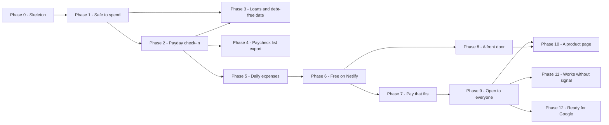

# ROADMAP

> [!abstract] Shape of the plan
> Four phases for v1, about five to six weeks at 20+ hours a week, then Phases 4 to 6, added after
> v1 was built. Phase 6 moves the app to a free Netlify and Supabase setup; Phase 7, added
> 2026-11-15, fits other pay rhythms and early payments; Phase 8, the same day, adds a public home
> page, and is built first because it is small. Phases 9 to 11, shaped late on 2026-11-15, open
> Payday to other people: their own budgets with an email and a password, a product page that sells
> it, and use without signal. On 2026-11-16 the product page went first, at the owner's choice, and
> sign-up changed from Google to email (no domain to buy). The riskiest assumption — that the owner keeps a payday habit, having never budgeted
> before — is tested from the first real payday after Phase 2. It can be tested sooner and for free: do the next two paydays as a check-in by hand, in a
> notes app, while Phases 0 and 1 are built.

| Phase | Goal | Exit | Status |
|---|---|---|---|
| 0 | Walking skeleton | Deployed, installable on both phones, backed up, budget measured | verified |
| 1 | Safe to spend | From nothing to a trustworthy number in under 20 minutes, privately | in-progress |
| 2 | Payday check-in | A real payday reminder leads to a check-in done in five minutes | in-progress |
| 3 | Loans and debt-free date | Every loan, the total, the monthly interest and the end date on one screen | verified |
| 4 | Paycheck list export | Any paycheck downloads as the owner's own list, as text, PDF or Word | in-progress |
| 5 | Daily expenses | An expense logged in seconds lowers the number; the check-in compares logged with spent | in-progress |
| 6 | Free on Netlify | The same app on Netlify and Supabase for $0, with backups you download | verified |
| 7 | Pay that fits | Paid every two weeks, twice a month or monthly, and a bill paid early counted once | done |
| 8 | A front door | A public home page in simple words, SEO 100 on the public pages | in-progress |
| 9 | Open to everyone | Anyone signs up with an email and a password and gets a private budget of their own, up to 100 accounts | verified |
| 10 | A product page | A product page that describes Payday accurately, shows the app, moves, and scores SEO 100 | verified |
| 11 | Works without signal | With no signal: the last number and plan, and expenses logged and sent later | planned |
| 12 | Ready for Google | "Continue with Google" fully built and switched off; the owner turns it on with two Netlify variables | verified |

Phase status: `planned` → `in-progress` → `verified` (`/setup`: every criterion it can check is
met) → `done` (`/ship`: the release is live).

Phase 3 needs the schedule from Phase 1, so loan payments count in the safe-to-spend number, and the
check-in from Phase 2, so loan balances can be confirmed at each check-in. Until then, loan payments
are entered as ordinary bills, so the number is right from Phase 1 onward.

---

## Phase 0 — Walking skeleton

**Goal.** A number read from the real database appears on the deployed app, installed on an iPhone and
an Android phone, with its data backed up and the performance budget measured.

**Epics.** [[Walking Skeleton Deployed]] · [[Installable App Shell]] · [[Backups And Restore Drill]]

**Exit criteria**
- [x] From a fresh clone, `cd app && pnpm install && pnpm dev` starts the app, and the home route shows a number read from SQLite through a migrated table. — verified 2026-10-31 on a clean copy of `app/`: 412.50 shown 14 s after install began
- [x] CI is green on a real Vitest unit test and a real Playwright test. — GitHub Actions run 41402666302 on PR #1, 2026-11-02
- [x] A new contributor gets from clone to running in under 15 minutes by following `app/README.md`. — verified 2026-10-31 by the same walk-through, following the README; not yet timed by a person
- [x] The JavaScript shipped for the home screen is measured from the production build and recorded in `SPECS.md`. — 33.5 KB gzipped against 60 KB, by budget.e2e.ts, 2026-10-31
- [ ] The app is deployed and reachable over HTTPS — at release
- [ ] It installs to the home screen and opens full-screen on an iPhone and an Android phone — at release
- [ ] A restore from object storage into a fresh volume brings back a row written before the drill — at release
- [ ] Every `SPECS.md` performance budget is measured on both phones against production and the numbers recorded — at release

> [!note] Status 2026-11-02 — verified
> CI ran green on the project's own repository, `jamesm-dev/payday-dev`, once PR #1 fixed the
> first run. The four criteria marked at release are `/ship`'s, and Phase 6 moves their host to
> Netlify.

> [!warning] A criterion the move to Netlify left behind
> "A restore from object storage into a fresh volume" describes Litestream, which Phase 6 removes
> with [[Backups And Restore Drill]] (cut). Its replacement is [[Backup Download And Restore]]. Amend
> or cut it with `/shape` before `/ship`; `/setup` does not rewrite the plan.

**Demo.** "This is the app on my home screen: tap, and the number from the database is there — and
here is that same database restored from backup."

> [!warning] Risks
> - Fly.io pricing or volume support differs from what `SPECS.md` assumes — early warning: the first
>   deploy needs more than one machine or a paid add-on. Fallback is a small VPS, per
>   [[ADR-0005 Fly.io As The Host]].
> - Litestream is not maintained or not compatible — early warning: no current release at setup.
>   Fallback is a scheduled `sqlite3 .backup`.
> - The native SQLite driver fails to build in the Docker image — early warning: the first image build.

**Non-goals.** Sign-in, any real financial data, any feature screen. The deployed skeleton holds
only fictional data until Phase 1's sign-in exists.

---

## Phase 1 — Safe to spend

**Goal.** Starting from nothing, the owner enters their pay, bills and loan payments in under 20
minutes and sees, behind a passkey, what is safe to spend until the next payday.

**Epics.** [[Private Single User Access]] · [[Schedule Of Pay And Bills]] ·
[[Paycheck Periods And Safe To Spend]] · [[Guided First Run Setup]]

**Exit criteria**
- [x] Every route except sign-in redirects to sign-in without a session, proven by a Playwright test that visits them all. — auth.e2e.ts over every route in tests/support/routes.ts, 2026-10-31
- [ ] A passkey registered on one device signs in on the other phone and the laptop, by adding a second passkey or the cross-device flow.
- [x] For the fixture household, the safe-to-spend number matches a hand calculation on five named dates — including a payday itself, a month-end and a three-paycheck month — in unit tests. — safeToSpend.test.ts, 2026-10-31
- [ ] Someone who did not build it completes first-run setup for the fixture household in under 20 minutes, timed, ending on the number.
- [x] The home screen shows the number, the next payday and what is reserved, at phone and laptop sizes. — home.e2e.ts on the iphone, android and laptop projects, 2026-10-31
- [x] The performance budget is re-checked with five years of generated data, and the numbers recorded. — performance.test.ts: p95 22.3 ms locally for 40 items and 600 overrides; home JavaScript 39.1 KB; recorded in SPECS.md, 2026-10-31
- [ ] The owner's real pay, bills and loan payments are entered on production — at release

> [!note] Status 2026-10-31 — in progress, built and tested locally
> 19 of 21 tasks verified. Two criteria need a person, not code: a passkey used on both real
> phones (Playwright's WebKit has no virtual authenticator), and someone who did not build it
> timing first-run setup. The real data is entered at release.

**Demo.** "I set up my pay and bills from scratch in fifteen minutes. This is what I can spend until
Friday, and this is everything already spoken for."

> [!warning] Risks
> - Passkeys inside the installed iPhone app behave differently from Safari — early warning: test
>   sign-in from the home-screen app first, before any other Phase 1 work.
> - Repeat-rule edge cases — the 29th to 31st, a payday on a bill's due date, a three-paycheck
>   month — swallow time. Early warning: the five-date fixture test is still red at mid-phase.
> - The owner does not know every bill and due date. Early warning: setup stalls at the bills step;
>   the last two bank statements are the source.

**Non-goals.** The check-in, reminders, loan balances and interest, any per-expense logging.

---

## Phase 2 — Payday check-in

**Goal.** On payday the phone reminds the owner, and a five-minute check-in turns the new balance into
what was spent and a plan for the next 14 days.

**Epics.** [[Payday Check-In Flow]] · [[Payday Reminder]] · [[Paycheck Plan View]]

**Exit criteria**
- [x] A Playwright test completes a check-in at phone size: pay confirmed, balance entered, spending shown, payments confirmed, plan shown. — checkin.e2e.ts on WebKit at iPhone size, 2026-10-31
- [x] For the fixture household, spending since the last check-in equals expected minus actual balance, and a payment marked missed stays reserved, in unit tests. — domain/checkin.test.ts, checkin.test.ts, 2026-10-31
- [x] The next six paychecks each show what they must cover, and a fixture paycheck that cannot cover its bills is flagged with the shortfall. — domain/plan.test.ts, phase2.e2e.ts, 2026-10-31
- [ ] A check-in on the fixture household takes five minutes or less by stopwatch, from opening the reminder to the plan shown.
- [ ] A payday reminder arrives on an installed iPhone and an Android phone at the chosen time and opens the check-in — at release
- [ ] The owner completes the first real payday check-in on their phone — at release

> [!note] Status 2026-10-31 — in progress, built and tested locally
> 12 of 13 tasks verified. Still to do, with a person and real phones: the five-minute
> stopwatch check-in, and subscribing to reminders from the installed app. Delivery of a real
> reminder and the first real check-in are checked at release.

**Demo.** "It's payday. The phone buzzed, I tapped it, confirmed my pay and balance — that's what I
spent these two weeks — and this is what the next paycheck has to cover."

> [!warning] Risks
> - Push on iPhone fails or the subscription silently expires — early warning: no reminder on the
>   first real payday. The calendar file is the fallback.
> - Spending paid by credit card is missed until the card is paid, which can make one check-in look
>   frugal and the next look terrible. Accepted until Phase 3; the check-in says so.
> - The machine is stopped when idle and the reminder job never runs — early warning: no log line on
>   payday. Auto-stop must be off, per [[ADR-0005 Fly.io As The Host]].

**Non-goals.** Loan balances and the debt-free date, payoff strategies, categories, imports.

---

## Phase 3 — Loans and debt-free date

**Goal.** Every loan, of all four kinds, is on one screen with the total owed, the interest it costs
each month and the date it will all be paid off — kept true at every check-in.

**Epics.** [[Loan Ledger]] · [[Debt Free Date Projection]] · [[Loan Balances At Check-In]]

**Exit criteria**
- [x] A credit card, an instalment loan, a buy-now-pay-later plan and an informal loan can each be entered with the fields their kind needs. — loans.test.ts, loans.e2e.ts, 2026-10-31
- [x] Each kind's payoff projection matches a reference calculation within one minor unit per period, in unit tests. — loans.test.ts, checked after every period, 2026-10-31
- [x] A loan whose payment does not cover its interest shows that it will never be paid off at this pace, instead of a date. — loans.test.ts, loans.e2e.ts, 2026-10-31
- [x] Loan payments are counted once in the safe-to-spend number, proven by a fixture test that converts a bill into a loan. — loans.test.ts, 2026-10-31
- [x] A check-in pre-fills each loan's expected balance, and a credit card's balance change counts toward spending. — checkinLoans.test.ts, loans.e2e.ts, 2026-10-31
- [x] The performance budget is re-checked with five years of generated data, and the numbers recorded. — performance.test.ts: home p95 30–63 ms and loans p95 57–70 ms locally with 8 loans and 130 check-ins; recorded in SPECS.md, 2026-10-31
- [ ] The owner's real loans are entered on production and the debt-free date is shown — at release

> [!note] Status 2026-10-31 — verified locally
> Every criterion that does not need a live release is met. Entering the real loans is checked
> at release by `/ship`.

**Demo.** "This is everything I owe: this much in total, costing me this much a month in interest, and
at this pace I'm free on this date. After today's check-in, it's this much lower."

> [!warning] Risks
> - The true rate or terms of a loan cannot be found — early warning: a loan saved with no rate. The
>   ledger shows it as unknown rather than guessing.
> - Credit-card minimum-payment rules differ by lender — early warning: the projection disagrees with
>   a statement. The rule is a field per card, not a constant.

**Non-goals.** Comparing payoff strategies ([[Debt Payoff Planner]]), refinancing what-ifs, imports.

---

## Phase 4 — Paycheck list export

Added by `/epic` on 2026-11-01, at the owner's request, after v1 was built. It reopens no earlier
phase.

**Goal.** Any of the next six paychecks downloads as a text file, a PDF or a Word document laid out
exactly as the owner's handwritten list, with what is optional and what is already paid marked.

**Epics.** [[Paid Optional And Grouped Bills]] · [[Paycheck List Export]]

**Exit criteria**
- [x] The owner's sample list reproduces line for line from the fixture, with every total computed, in a unit test. — domain/paycheckList.test.ts, 2026-11-01
- [x] A bill marked paid on the plan is ticked at the next check-in, and marking bills paid or optional leaves the safe-to-spend number unchanged, in tests. — money/paycheckList.test.ts, 2026-11-01
- [x] A Playwright test downloads the text file, the PDF and the Word document and checks their contents. — export.e2e.ts on WebKit, Android and laptop; marks.e2e.ts at iPhone size, 2026-11-01
- [ ] The three files open in Notepad, a PDF viewer and Word on the owner's laptop.
- [ ] A download from the installed app works on an iPhone and an Android phone — at release

> [!note] Status 2026-11-01 — in progress, built and tested locally
> 10 of 11 tasks verified. One criterion needs the owner: opening the three files in Notepad, a PDF
> reader and Word on the laptop. Downloads on both phones are checked at release.

**Demo.** "This is my list for Friday's salary: same as I write it, with the paid ones ticked. Here
it is as a PDF."

> [!warning] Risks
> - The owner's group order is hand-made; blocks follow each group's earliest due date. Early
>   warning: the owner reorders the exported list by hand.
> - Downloads in the installed iPhone app open a preview sheet. Early warning: no file is saved on the
>   first try.

**Non-goals.** Spending categories, spreadsheets, a monthly list, sharing links, any change to the
safe-to-spend number.

---

## Phase 5 — Daily expenses

Added by `/epic` on 2026-11-02, at the owner's request. It reopens no earlier phase, and supersedes
the v1 non-goal on logging expenses
([[ADR-0012 Logged Expenses Count Until The Next Balance]]). Built on the current stack, before any
move of host.

**Goal.** An expense is logged in a few seconds and lowers the safe-to-spend number at once, and the
payday check-in shows what was logged against what the bank says was spent.

**Epics.** [[Daily Expense Log]] · [[Expenses At Check-In]]

**Exit criteria**
- [x] An expense logged on the home screen lowers the number by its amount at once, in a browser test at iPhone, Android and laptop sizes. — expenses.e2e.ts on all three, 2026-11-02
- [x] A fresh balance, from the home screen or a check-in, takes over from the expenses before it, so none is counted twice, in unit tests. — domain/safeToSpend.test.ts, money/expenses.test.ts, money/checkinLogged.test.ts, 2026-11-02
- [x] The check-in shows logged, spent and not logged, and counts a card purchase once, in tests. — money/checkinLogged.test.ts, spent-vs-logged.e2e.ts, 2026-11-02
- [x] The home screen stays inside its performance budget with a year of daily expenses. — performance.test.ts: home p95 20.2 ms locally with 365 expenses; budget.e2e.ts green in CI, 2026-11-02
- [ ] The owner logs an expense on their own phone in under ten seconds, timed.

> [!note] Status 2026-11-02 — in progress, built and tested
> All 14 tasks verified: 842 unit and 515 browser tests green in CI on the project's own repository.
> One criterion needs the owner: logging an expense on their own phone in under ten seconds, timed.

**Demo.** "Lunch, 250: done, and my number went down by 250. At payday the check-in says I logged
4,100 and the bank says I spent 4,600: 500 I forgot."

> [!warning] Risks
> - Daily logging is the habit that never started. Early warning: a payday check-in with nothing
>   logged since the last one. Logging stays optional, so the plan still works without it.
> - A card purchase is spent before the bank shows it. Early warning: a check-in whose "not logged"
>   is negative by about the card's change.

**Non-goals.** Categories, budgets per category, receipts or photos, expenses that repeat (those are
bills), splitting an expense, importing from a bank.

---

## Phase 6 — Free on Netlify

Added on 2026-11-02, at the owner's request: "i want it to be free, hosted in netlify… remove the
reminders if need be… use supabase if need be." It supersedes the host, the database, the migration
timing and the push reminders ([[ADR-0013 Netlify As The Host]],
[[ADR-0014 Supabase Postgres As The Database]], [[ADR-0015 Migrations Run At Deploy]],
[[ADR-0016 Reminders By Calendar File Only]]). [[Backups And Restore Drill]] and
[[Payday Reminder]] are cut; the Fly parts of [[Walking Skeleton Deployed]] are amended to Netlify.

**Goal.** The same app, on Netlify's free plan with its data in Supabase, costs nothing, and the
owner can download and restore a full backup.

**Epics.** [[Backup Download And Restore]] · [[Postgres On Supabase]] ·
[[Sign-In State In The Database]] · [[Deploy On Netlify]]

**Exit criteria**
- [x] Every unit and browser test passes on Postgres (PGlite), with no Docker and no network. — 930 unit and 523 browser tests, 558e8ef, 2026-11-15
- [x] A backup downloaded from the current app restores into the Postgres version, and the number matches, in a test. — fullBackup.test.ts restores the SQLite-era fixture to its number, byte-identical on re-export; the owner's real backup was checked the same way, 2026-11-14
- [x] Sign-in limits and the 5-minute confirmation hold across separate function instances, in tests. — the cross-instance tests in 09c1eba, and live on Supabase through four connections, 2026-11-15
- [x] The app's tables cannot be reached through Supabase's public data API. — live on project `payday` after the first deploy: the REST API answers 406 PGRST106 for the `payday` and `drizzle` schemas and 404 in `public`, `anon` and `authenticated` hold no grant on either schema, and Supabase's security advisor lists nothing, 2026-11-15
- [x] The production build for Netlify passes, and the performance budget is measured again. — Netlify deploy 6af8ecd2 built and published c727e13; home-screen JavaScript 53.1 KB gzipped of 60 (budget.e2e.ts), home p95 12.5 to 15.8 ms and loans p95 29.8 ms locally with five years of data (performance.test.ts), 2026-11-15. Phone timings on production wait for `/ship`.
- [ ] Deployed on Netlify with Supabase, reachable over HTTPS, for $0 — at release

> [!note] Status 2026-11-15 — verified, and live
> Every criterion that does not need the release is met. The site went live at
> payday-birc.netlify.app on 2026-11-15 (deploy 6af8ecd2), and the owner registered on it. Left for
> `/ship`: the owner's backup restored on production, and the last criterion, "$0 at release".

**Demo.** "It's on Netlify now, free. Here's my backup from last night, restored: same number."

> [!warning] Risks
> - The largest change since setup: every store, route and test. Built in slices, each green first.
> - Supabase pauses a free project after a quiet week; the app is down until it is restored in the
>   dashboard.
> - Netlify's 300 monthly credits are a hard cap, and each deploy costs 15.

**Non-goals.** Supabase's own sign-in, storage or realtime; push notifications; automatic backups;
more than one user.

---

## Phase 7 — Pay that fits

Added by `/epic` on 2026-11-15, at the owner's request: "allow users to pay early for the upcoming
bills and things. on check-in, allow users to choose bi-weekly or monthly pay". It reopens no
earlier phase. It amends SPECS decision 13 for early payments
([[ADR-0020 Early Payments Count Until The Next Balance]]) and the SPECS assumption that pay comes
every 14 days ([[ADR-0021 Pay Rhythm Is A Setting]]). Built after Phase 6 is released.

**Goal.** Someone paid every two weeks, twice a month or once a month gets a right number and plan
for their own paydays, and a bill they pay early comes off the number at once and is counted once.

**Epics.** [[Paydays From Any Pay Rhythm]] · [[Choose How Often You Are Paid]] ·
[[Early Payments Count Once]] — 19 tasks, 49 points (one added during the build, at the
owner's choice: "Paid early" for a bill in the current paycheck).

**Exit criteria**
- [x] Every existing every-14-days fixture keeps its value, and new hand-calculated fixtures for twice-a-month and monthly pay pass through a full year. — no existing domain test or fixture edited; periods.rhythm, plan.rhythm and safeToSpend.rhythm tests run a year of the 15th and last day and of monthly on the 31st, with February and a leap year, 2026-11-15
- [x] A twice-a-month and a monthly owner each finish guided setup and a payday update at phone size, in browser tests, with no "14 days" or "two weeks" shown to them. — rhythm.e2e.ts at iPhone size, setup screens included, 2026-11-15
- [x] A bill paid early lowers the number by its amount at once and is not held back again, whatever balance comes next, in unit and browser tests. — safeToSpend.early, plan.early, edges.early, earlyMarks and reviewFixes tests; marks.e2e.ts TSK-500C4F and TSK-342C1F, 2026-11-15
- [x] A backup from before Phase 7 restores unchanged, as every 14 days. — fullBackup.test.ts TSK-86C4B3: the version 1 fixture keeps its number, its main pay inferred as migration 0003 does, 2026-11-15
- [x] The home screen stays inside its performance budget for all three rhythms. — home p95 15.4 ms every 14 days, 14.7 ms twice a month and 16.0 ms monthly with five years of data (150 ms budget); home JavaScript 54.9 KB of 60, 2026-11-15

> [!note] Status 2026-11-15 — verified
> Built and verified on branch `phase-7-pay-that-fits`: 1,175 unit and 579 browser tests pass, lint,
> typecheck and the Netlify build too. Three review rounds (a slice review of each part, an engine
> review and three integration rounds) asked for changes; all were made. One task was added during
> the build at the owner's choice: "Paid early" for a bill in the current paycheck. Migrations 0002
> to 0005 run on Supabase at the next deploy; `/ship` sets the phase done once it is live.

> [!success] Released 2026-11-16 — done
> Live in deploy 6af9eb66 from the merge of pull request #7 (d93498d), after its checks passed.
> Migrations 0002 to 0005 ran on Supabase at the deploy: both new pay columns, the loan figure's
> read time and the one-main-pay index are there, and exactly one main pay is marked. The public
> pages answer on the live site.

**Demo.** "My sister is paid on the 15th and the 30th. Setup asked, and her plan shows the 30th as
her next payday. I paid the water bill early today: my number dropped by 850, and next paycheck
no longer keeps money for it."

> [!warning] Risks
> - The largest change to the money engine since Phase 1: every number depends on the paydays.
>   Fixtures first, and none of today's may change.
> - Early marks trust the owner. A mark that is not a real payment makes the number too high until
>   the next payday update.

**Non-goals.** Two jobs or more than one main pay; pay with no regular rhythm; weekends and public
holidays moving a payday; many people on one site and offline use (both for `/shape`).

---

## Phase 8 — A front door

Added by `/epic` on 2026-11-15, at the owner's request: "the app should pass the SEO testing 100%
if possible", then "yes, create a homepage for the app with contents simple enough for the users to
be attracted to use it". It depends only on Phase 6, so it is built before Phase 7. Sign-up stays
closed: the page's sign-up button waits for [[Many People On One Site]], which needs `/shape`.

**Goal.** A visitor who is not signed in finds a public home page that says what Payday does in
simple words and makes them want to try it, and the public pages pass a search-engine audit.

**Epics.** [[Public Home Page]] — 6 tasks, 13 points.

**Exit criteria**
- [x] A signed-out visitor at `/` sees the home page with a 200; a signed-in owner sees the number; no private page answers a signed-out visitor, in a test of every route. — guard.test.ts sweeps every route in `src/routes`, auth.e2e.ts every protected route on a running build, landing.e2e.ts at three sizes; security review approved, 2026-11-15
- [x] Lighthouse SEO is 100 on `/` and `/signin` on the deployed site, mobile setting. — Lighthouse 13.6.0, mobile, on payday-birc.netlify.app after deploy 6af97c2c (31d16ca): SEO 100 and accessibility 100 on both, 2026-11-15
- [ ] Someone who did not write it, older or not a native English speaker, reads the page and says back what Payday does.

> [!note] Status 2026-11-15 — in progress, live
> Live since deploy 6af97c2c, and [[Public Home Page]] is done: all 6 tasks verified, the live
> Lighthouse audit included. Left: a reader who did not write the page, a check only a person can
> do. (This criterion sat below the status note; moved above it, its text unchanged.)

**Demo.** "Open the site without signing in: one screen that says what Payday is, in words my
mother reads without help. Lighthouse SEO: 100."

> [!warning] Risks
> - The guard is a caution path. A public `/` must not open a private page by accident.
> - A page that attracts people before they can sign up. Its honest note says accounts for new
>   people are not open yet.

**Non-goals.** Sign-up, accounts for other people, a blog or other content pages, analytics or
tracking scripts, paid ads.

---

## Phase 9 — Open to everyone

Shaped by `/shape` on 2026-11-15, at the owner's request: "many users can login via site so that
users can see their budget accurately the same even if they switch devices", then "Open sign-up
now" for the product page's button. It reverses the SPECS non-goal "Other users, sign-up"
([[ADR-0022 Open Sign-Up With A Limit]]). Built after Phase 7, so every new person can choose
how often they are paid.

> [!important] Changed 2026-11-16: email and password, not Google
> At the owner's request ("avoid anything path right now that requires me to buy a domain, I'm
> okay with users signing up even dummy emails"), new people sign up with an email and a
> password, and the email is not checked ([[ADR-0026 Email And Password Sign-Up For Now]],
> superseding [[ADR-0023 Google Sign-In For New Accounts]]). [[Sign In With Google]] is cut;
> [[Sign Up With Email And Password]] replaces it.

> [!note] Status 2026-11-16 — verified
> Built on branch `phase-9-open-to-everyone` in nine slices, each reviewed, then a security review
> and an integration review whose findings were all fixed. 18 of 18 tasks; every exit criterion
> met except the one only a release can prove: the owner's real backup through
> `scripts/check-owner-migration.ts` before the deploy that runs migration 0006. A backup from
> another account restores only after a tick ([[ADR-0027 A Backup From Another Account Needs A Tick]]).
> The privacy contact is payday@jamesm-dev.com, the owner's choice. `/ship` sets the phase done once
> it is live.

**Goal.** Anyone can create a free account with an email and a password and get a private budget
of their own, the same on every device, up to 100 accounts, while the owner's budget stays exactly
as it is.

**Epics.** [[Every Budget Has Its Owner]] · [[Sign Up With Email And Password]] ·
[[Your Account And Your Data]] — 18 tasks, 48 points.

**Exit criteria**
- [x] Two people signed in at once can never see, change, download or restore each other's budget, proven by a test of every route. — ownership.test.ts, passkeyOwnership.test.ts and people-account.e2e.ts, 2026-11-16
- [x] A new person creates an account with an email and a password at phone size, lands in guided setup with an empty budget, and signs in again later to the same budget, in browser tests. — people-journey.e2e.ts, 2026-11-16
- [ ] The owner's budget is unchanged after the migration: the same number, plan, loans and history, checked on a copy of the real backup before the deploy. — at release: proven on a fictional version 2 backup (ownerMigration.test.ts); the owner's real backup goes through scripts/check-owner-migration.ts before the deploy
- [x] The 101st account is refused in plain words, and nothing about that visitor is stored. — signUp.test.ts, Landing.test.ts, 2026-11-16
- [x] A person can read the privacy notice, download their budget and delete their account, and after deleting, no table holds their id. — privacy.e2e.ts, fullBackup.test.ts, deleteAccount.test.ts and people-account.e2e.ts, 2026-11-16
- [x] The home screen stays inside its performance budget with 100 people's five years of data. — home p95 32.7 ms, loans 58.9 ms (150 ms), performanceMany.test.ts, 2026-11-16

**Demo.** "My cousin opened Payday on her phone, made an account with her email and a password,
and set up her own budget. She cannot see mine, and I cannot see hers. When she deleted her test account, it was gone."

> [!warning] Risks
> - One unscoped query shows a stranger's money: the reason for the sweep test of every route.
> - An email nobody checks: a person who forgets the password and loses the recovery codes loses
>   the budget. The sign-up screen says so.
> - The free plans were sized for one person: the 100-account limit, and a look at Netlify's credits
>   and Supabase's limits at 80 accounts.

**Non-goals.** Checking emails, email password reset and Google sign-in (each needs a domain; Google
sign-in is built switched off in Phase 12, [[ADR-0028 Google Sign-In Built Switched Off]]);
sharing one budget between people; families or households; an admin screen; paid plans.

---

## Phase 10 — A product page

Shaped the same day, at the owner's request: "what I want to build instead of homepage is a landing
page to attract users to use the app", "imagine it a product page that should have perfect SEO,
accurate description what the app is", and "make sure landing page is interactive, use anime.js"
([[ADR-0025 Anime.js For The Landing Page]]). It replaces Phase 8's plain page at the same address.

> [!note] Status 2026-11-16 — verified
> The owner said "landing page is sooo ugly" and chose "Product page first": built ahead of
> Phase 9 and live since deploy 6afa007f (Lighthouse mobile on the live site: SEO 100,
> accessibility 100, performance 100). Its "Create a free account" button and the full state came
> with Phase 9, so the phase is done once Phase 9 is live.

**Goal.** A visitor finds a product page that says accurately what Payday is and is not, shows the
real app, invites them to try an example, and starts their account with one tap.

**Epics.** [[Product Landing Page]] — 7 tasks, 22 points.

**Exit criteria**
- [x] Lighthouse on the live site, mobile: SEO 100 and accessibility at least 95 on the product page. — deploy 6afa007f: SEO 100, accessibility 100, performance 100, 2026-11-16
- [x] Every claim on the page is checked against the app in a test, and the page says plainly it is a budget app, not a loan. — landing.e2e.ts TSK-d22bce and TSK-c7fcd1 at three sizes, 2026-11-16
- [x] The "try it" example and the motion work on a phone, the page reads in full without JavaScript, and nothing moves with reduced motion set. — landing.e2e.ts TSK-619b8d and TSK-2c985a at iPhone, Android and laptop sizes, 2026-11-16
- [x] The first screen shows within 2 seconds on 4G, and the signed-in home screen stays within its 60 KB. — 1.8 s in Lighthouse mobile on simulated slow 4G; the page loads only for visitors (TSK-121277), and rhythm.e2e.ts holds the home screen under 60 KB, 2026-11-16
- [x] "Create a free account" on the page creates an account; when sign-up is full, the page says so. (Was "Continue with Google"; changed by ADR-0026, 2026-11-16.) — people-journey.e2e.ts and Landing.test.ts, 2026-11-16; live with Phase 9

**Demo.** "Search brought my neighbour to Payday. She moved the sliders, saw how the number works,
and tapped Create a free account. Lighthouse SEO: 100."

> [!warning] Risks
> - The name "Payday" reads as a payday lender in search; the page must say otherwise at once, and a
>   new name stays an open question.
> - Motion that slows the page or hides text from search.

**Non-goals.** A blog or other content pages, other languages (English only for now), analytics or
tracking scripts, paid ads, a new name or domain.

---

## Phase 11 — Works without signal

Shaped the same day, at the owner's request: "make sure they can also use things even offline"
([[ADR-0024 Offline Copy And Queued Expenses]]).

**Goal.** With no signal, the installed app shows the last number and plan, clearly dated, and an
expense logged offline reaches the site exactly once when the signal returns.

**Epics.** [[Offline Number And Expenses]] — 6 tasks, 21 points.

**Exit criteria**
- [ ] With the network off, the home screen shows the last number and plan marked "Offline: from <day and time>", in a browser test.
- [ ] An expense logged offline lowers the shown number at once and is saved on the site exactly once when the network returns, even when sent twice.
- [ ] Expenses logged offline on two phones end up once each on both.
- [ ] Signing out removes the copy and any unsent expenses from the phone.
- [ ] The home screen stays inside its 60 KB JavaScript budget with the offline code.

**Demo.** "In the supermarket with no signal I still saw my number and logged the groceries. Back
home, it was on my laptop too, once."

> [!warning] Risks
> - A confidently wrong number from an old copy: every offline number carries its time.
> - Money data left on a shared or lost phone: removed on sign-out, tested.

**Non-goals.** Offline payday updates, editing bills or pay offline, offline sign-in.

---

## Phase 12 — Ready for Google

Shaped on 2026-11-16, at the owner's request: "make sure to prepare everything to when I enable
user login via google" ([[ADR-0028 Google Sign-In Built Switched Off]], amending
[[ADR-0026 Email And Password Sign-Up For Now]]). Built on Phase 9, which ships as it was verified.

**Goal.** "Continue with Google" is completely built, tested against a fake Google and shipped
switched off, so that the owner turns it on by setting two Netlify variables and deploying.

**Epics.** [[Continue With Google]] — 10 tasks, 24 points.

> [!note] Status 2026-11-16 — verified
> Built on branch `phase-12-google-ready`, on top of Phase 9, and switched off. A security review
> found seven issues (among them passkey challenges evicted by Google flows, and a Google sign-in
> earning a 5-minute step-up), all fixed. 1,496 unit and 663 browser tests, the Netlify build and
> its smoke tests pass. Left for release: the owner turns it on by app/README.md and signs in.

**Exit criteria**
- [x] Off means nothing shows or answers: no "Google" on any page and the Google routes return 404, in the Netlify smoke test and in browser tests. — people-google.e2e.ts and the Netlify smoke tests, 2026-11-16
- [x] The whole flow passes against a fake Google on iPhone and laptop: a newcomer sees recovery codes, reaches guided setup, and signs in again to the same budget. — people-google.e2e.ts, 2026-11-16
- [x] An email that matches an existing account is refused in plain words, and nothing is linked. — accounts.test.ts and people-google.e2e.ts, 2026-11-16
- [x] Connect and disconnect work in Settings › Security, and disconnecting the last way in is refused. — people-google.e2e.ts and the security page tests, 2026-11-16
- [x] A forged, expired, replayed or wrong-audience token is refused, and so is a callback from another browser. — oidc.test.ts, complete.test.ts and people-google.e2e.ts, 2026-11-16
- [x] Deletion and the two-person sweep still hold: after deleting, no table holds the person's Google id, and one person cannot act as another. — deleteAccount.test.ts and ownership.test.ts, 2026-11-16
- [ ] At release, the owner switches it on and signs in with a real Google account. — at release: the owner's step, by app/README.md

**Demo.** "I added two variables in Netlify and deployed. A button appeared. I tapped it, chose my
Google account, and my budget opened. With the variables empty, the button was never there."

> [!warning] Risks
> - Google may refuse an unverified `netlify.app` address. The how-to recommends verifying
>   `jamesm-dev.com` or moving to `payday.jamesm-dev.com`, then adding a second redirect address.
> - Switching it off later strands people who have only Google; they would have only their
>   recovery codes.
> - Trusting the ID token from Google's token endpoint instead of its signing keys is allowed by the
>   standard but is a choice; it is recorded in the ADR and tested.
> - Auth, sign-in and Settings › Security are on the Caution list: every change is reviewed.

**Non-goals.** Linking by matching email, other providers (Apple, Facebook), a sign-up that skips
the account limit, checking emails, email reset, and turning it on (the owner's step, at release).

---

## After v1 — not committed

Candidates for the next `/shape` or `/epic`, in the order the plan would reach for them:
[[Debt Payoff Planner]], [[Bank Statement Import]], [[Cash Flow Runway]],
[[AI Capture From Screenshots]], [[Live Bank Sync]].

[[Many People On One Site]] and [[Offline Use With Sync]] were shaped on 2026-11-15 into Phases 9
and 11, and [[Found In Search]] into Phases 8 and 10. Left for later: email and password sign-up
(needs a domain, [[ADR-0023 Google Sign-In For New Accounts]]; Google sign-in itself is Phase 12,
built switched off), a name that search does not read as
a payday loan, and Filipino alongside English.
