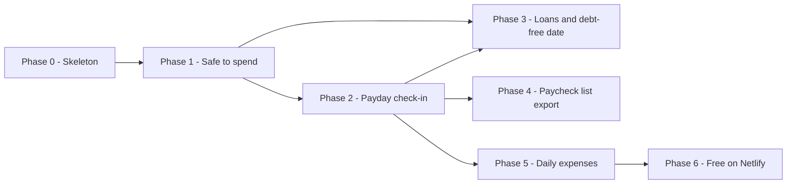

# ROADMAP

> [!abstract] Shape of the plan
> Four phases for v1, about five to six weeks at 20+ hours a week, then Phases 4 to 6, added after
> v1 was built. Phase 6 moves the app to a free Netlify and Supabase setup. The riskiest assumption — that the owner keeps a payday habit, having never budgeted
> before — is tested from the first real payday after Phase 2. It can be tested sooner and for free: do the next two paydays as a check-in by hand, in a
> notes app, while Phases 0 and 1 are built.

| Phase | Goal | Exit | Status |
|---|---|---|---|
| 0 | Walking skeleton | Deployed, installable on both phones, backed up, budget measured | in-progress |
| 1 | Safe to spend | From nothing to a trustworthy number in under 20 minutes, privately | in-progress |
| 2 | Payday check-in | A real payday reminder leads to a check-in done in five minutes | in-progress |
| 3 | Loans and debt-free date | Every loan, the total, the monthly interest and the end date on one screen | verified |
| 4 | Paycheck list export | Any paycheck downloads as the owner's own list, as text, PDF or Word | in-progress |
| 5 | Daily expenses | An expense logged in seconds lowers the number; the check-in compares logged with spent | planned |
| 6 | Free on Netlify | The same app on Netlify and Supabase for $0, with backups you download | planned |

Phase status: `planned` → `in-progress` → `verified` (`/setup`: every criterion it can check is
met) → `done` (`/ship`: the release is live).

Phase 3 needs the schedule from Phase 1, so loan payments count in the safe-to-spend number, and the
check-in from Phase 2, so loan balances can be confirmed at each check-in. Until then, loan payments
are entered as ordinary bills, so the number is right from Phase 1 onward.

---

## Phase 0 — Walking skeleton

**Goal.** A number read from the real database appears on the deployed app, installed on an iPhone and
an Android phone, with its data backed up and the performance budget measured.

**Epics.** [[Walking Skeleton Deployed]] · [[Installable App Shell]] · [[Backups And Restore Drill]]

**Exit criteria**
- [x] From a fresh clone, `cd app && pnpm install && pnpm dev` starts the app, and the home route shows a number read from SQLite through a migrated table. — verified 2026-10-31 on a clean copy of `app/`: 412.50 shown 14 s after install began
- [ ] CI is green on a real Vitest unit test and a real Playwright test.
- [x] A new contributor gets from clone to running in under 15 minutes by following `app/README.md`. — verified 2026-10-31 by the same walk-through, following the README; not yet timed by a person
- [x] The JavaScript shipped for the home screen is measured from the production build and recorded in `SPECS.md`. — 33.5 KB gzipped against 60 KB, by budget.e2e.ts, 2026-10-31
- [ ] The app is deployed and reachable over HTTPS — at release
- [ ] It installs to the home screen and opens full-screen on an iPhone and an Android phone — at release
- [ ] A restore from object storage into a fresh volume brings back a row written before the drill — at release
- [ ] Every `SPECS.md` performance budget is measured on both phones against production and the numbers recorded — at release

> [!note] Status 2026-10-31 — in progress, not yet verified
> Built by `/setup` and checked locally. One criterion that needs no release is still open:
> CI has never run, because the project has no GitHub repository yet — the owner chose to keep
> it local for now. The four criteria marked at release are `/ship`'s.

**Demo.** "This is the app on my home screen: tap, and the number from the database is there — and
here is that same database restored from backup."

> [!warning] Risks
> - Fly.io pricing or volume support differs from what `SPECS.md` assumes — early warning: the first
>   deploy needs more than one machine or a paid add-on. Fallback is a small VPS, per
>   [[ADR-0005 Fly.io As The Host]].
> - Litestream is not maintained or not compatible — early warning: no current release at setup.
>   Fallback is a scheduled `sqlite3 .backup`.
> - The native SQLite driver fails to build in the Docker image — early warning: the first image build.

**Non-goals.** Sign-in, any real financial data, any feature screen. The deployed skeleton holds
only fictional data until Phase 1's sign-in exists.

---

## Phase 1 — Safe to spend

**Goal.** Starting from nothing, the owner enters their pay, bills and loan payments in under 20
minutes and sees, behind a passkey, what is safe to spend until the next payday.

**Epics.** [[Private Single User Access]] · [[Schedule Of Pay And Bills]] ·
[[Paycheck Periods And Safe To Spend]] · [[Guided First Run Setup]]

**Exit criteria**
- [x] Every route except sign-in redirects to sign-in without a session, proven by a Playwright test that visits them all. — auth.e2e.ts over every route in tests/support/routes.ts, 2026-10-31
- [ ] A passkey registered on one device signs in on the other phone and the laptop, by adding a second passkey or the cross-device flow.
- [x] For the fixture household, the safe-to-spend number matches a hand calculation on five named dates — including a payday itself, a month-end and a three-paycheck month — in unit tests. — safeToSpend.test.ts, 2026-10-31
- [ ] Someone who did not build it completes first-run setup for the fixture household in under 20 minutes, timed, ending on the number.
- [x] The home screen shows the number, the next payday and what is reserved, at phone and laptop sizes. — home.e2e.ts on the iphone, android and laptop projects, 2026-10-31
- [x] The performance budget is re-checked with five years of generated data, and the numbers recorded. — performance.test.ts: p95 22.3 ms locally for 40 items and 600 overrides; home JavaScript 39.1 KB; recorded in SPECS.md, 2026-10-31
- [ ] The owner's real pay, bills and loan payments are entered on production — at release

> [!note] Status 2026-10-31 — in progress, built and tested locally
> 19 of 21 tasks verified. Two criteria need a person, not code: a passkey used on both real
> phones (Playwright's WebKit has no virtual authenticator), and someone who did not build it
> timing first-run setup. The real data is entered at release.

**Demo.** "I set up my pay and bills from scratch in fifteen minutes. This is what I can spend until
Friday, and this is everything already spoken for."

> [!warning] Risks
> - Passkeys inside the installed iPhone app behave differently from Safari — early warning: test
>   sign-in from the home-screen app first, before any other Phase 1 work.
> - Repeat-rule edge cases — the 29th to 31st, a payday on a bill's due date, a three-paycheck
>   month — swallow time. Early warning: the five-date fixture test is still red at mid-phase.
> - The owner does not know every bill and due date. Early warning: setup stalls at the bills step;
>   the last two bank statements are the source.

**Non-goals.** The check-in, reminders, loan balances and interest, any per-expense logging.

---

## Phase 2 — Payday check-in

**Goal.** On payday the phone reminds the owner, and a five-minute check-in turns the new balance into
what was spent and a plan for the next 14 days.

**Epics.** [[Payday Check-In Flow]] · [[Payday Reminder]] · [[Paycheck Plan View]]

**Exit criteria**
- [x] A Playwright test completes a check-in at phone size: pay confirmed, balance entered, spending shown, payments confirmed, plan shown. — checkin.e2e.ts on WebKit at iPhone size, 2026-10-31
- [x] For the fixture household, spending since the last check-in equals expected minus actual balance, and a payment marked missed stays reserved, in unit tests. — domain/checkin.test.ts, checkin.test.ts, 2026-10-31
- [x] The next six paychecks each show what they must cover, and a fixture paycheck that cannot cover its bills is flagged with the shortfall. — domain/plan.test.ts, phase2.e2e.ts, 2026-10-31
- [ ] A check-in on the fixture household takes five minutes or less by stopwatch, from opening the reminder to the plan shown.
- [ ] A payday reminder arrives on an installed iPhone and an Android phone at the chosen time and opens the check-in — at release
- [ ] The owner completes the first real payday check-in on their phone — at release

> [!note] Status 2026-10-31 — in progress, built and tested locally
> 12 of 13 tasks verified. Still to do, with a person and real phones: the five-minute
> stopwatch check-in, and subscribing to reminders from the installed app. Delivery of a real
> reminder and the first real check-in are checked at release.

**Demo.** "It's payday. The phone buzzed, I tapped it, confirmed my pay and balance — that's what I
spent these two weeks — and this is what the next paycheck has to cover."

> [!warning] Risks
> - Push on iPhone fails or the subscription silently expires — early warning: no reminder on the
>   first real payday. The calendar file is the fallback.
> - Spending paid by credit card is missed until the card is paid, which can make one check-in look
>   frugal and the next look terrible. Accepted until Phase 3; the check-in says so.
> - The machine is stopped when idle and the reminder job never runs — early warning: no log line on
>   payday. Auto-stop must be off, per [[ADR-0005 Fly.io As The Host]].

**Non-goals.** Loan balances and the debt-free date, payoff strategies, categories, imports.

---

## Phase 3 — Loans and debt-free date

**Goal.** Every loan, of all four kinds, is on one screen with the total owed, the interest it costs
each month and the date it will all be paid off — kept true at every check-in.

**Epics.** [[Loan Ledger]] · [[Debt Free Date Projection]] · [[Loan Balances At Check-In]]

**Exit criteria**
- [x] A credit card, an instalment loan, a buy-now-pay-later plan and an informal loan can each be entered with the fields their kind needs. — loans.test.ts, loans.e2e.ts, 2026-10-31
- [x] Each kind's payoff projection matches a reference calculation within one minor unit per period, in unit tests. — loans.test.ts, checked after every period, 2026-10-31
- [x] A loan whose payment does not cover its interest shows that it will never be paid off at this pace, instead of a date. — loans.test.ts, loans.e2e.ts, 2026-10-31
- [x] Loan payments are counted once in the safe-to-spend number, proven by a fixture test that converts a bill into a loan. — loans.test.ts, 2026-10-31
- [x] A check-in pre-fills each loan's expected balance, and a credit card's balance change counts toward spending. — checkinLoans.test.ts, loans.e2e.ts, 2026-10-31
- [x] The performance budget is re-checked with five years of generated data, and the numbers recorded. — performance.test.ts: home p95 30–63 ms and loans p95 57–70 ms locally with 8 loans and 130 check-ins; recorded in SPECS.md, 2026-10-31
- [ ] The owner's real loans are entered on production and the debt-free date is shown — at release

> [!note] Status 2026-10-31 — verified locally
> Every criterion that does not need a live release is met. Entering the real loans is checked
> at release by `/ship`.

**Demo.** "This is everything I owe: this much in total, costing me this much a month in interest, and
at this pace I'm free on this date. After today's check-in, it's this much lower."

> [!warning] Risks
> - The true rate or terms of a loan cannot be found — early warning: a loan saved with no rate. The
>   ledger shows it as unknown rather than guessing.
> - Credit-card minimum-payment rules differ by lender — early warning: the projection disagrees with
>   a statement. The rule is a field per card, not a constant.

**Non-goals.** Comparing payoff strategies ([[Debt Payoff Planner]]), refinancing what-ifs, imports.

---

## Phase 4 — Paycheck list export

Added by `/epic` on 2026-11-01, at the owner's request, after v1 was built. It reopens no earlier
phase.

**Goal.** Any of the next six paychecks downloads as a text file, a PDF or a Word document laid out
exactly as the owner's handwritten list, with what is optional and what is already paid marked.

**Epics.** [[Paid Optional And Grouped Bills]] · [[Paycheck List Export]]

**Exit criteria**
- [x] The owner's sample list reproduces line for line from the fixture, with every total computed, in a unit test. — domain/paycheckList.test.ts, 2026-11-01
- [x] A bill marked paid on the plan is ticked at the next check-in, and marking bills paid or optional leaves the safe-to-spend number unchanged, in tests. — money/paycheckList.test.ts, 2026-11-01
- [x] A Playwright test downloads the text file, the PDF and the Word document and checks their contents. — export.e2e.ts on WebKit, Android and laptop; marks.e2e.ts at iPhone size, 2026-11-01
- [ ] The three files open in Notepad, a PDF viewer and Word on the owner's laptop.
- [ ] A download from the installed app works on an iPhone and an Android phone — at release

> [!note] Status 2026-11-01 — in progress, built and tested locally
> 10 of 11 tasks verified. One criterion needs the owner: opening the three files in Notepad, a PDF
> reader and Word on the laptop. Downloads on both phones are checked at release.

**Demo.** "This is my list for Friday's salary: same as I write it, with the paid ones ticked. Here
it is as a PDF."

> [!warning] Risks
> - The owner's group order is hand-made; blocks follow each group's earliest due date. Early
>   warning: the owner reorders the exported list by hand.
> - Downloads in the installed iPhone app open a preview sheet. Early warning: no file is saved on the
>   first try.

**Non-goals.** Spending categories, spreadsheets, a monthly list, sharing links, any change to the
safe-to-spend number.

---

## Phase 5 — Daily expenses

Added by `/epic` on 2026-11-02, at the owner's request. It reopens no earlier phase, and supersedes
the v1 non-goal on logging expenses
([[ADR-0012 Logged Expenses Count Until The Next Balance]]). Built on the current stack, before any
move of host.

**Goal.** An expense is logged in a few seconds and lowers the safe-to-spend number at once, and the
payday check-in shows what was logged against what the bank says was spent.

**Epics.** [[Daily Expense Log]] · [[Expenses At Check-In]]

**Exit criteria**
- [ ] An expense logged on the home screen lowers the number by its amount at once, in a browser test at iPhone, Android and laptop sizes.
- [ ] A fresh balance, from the home screen or a check-in, takes over from the expenses before it, so none is counted twice, in unit tests.
- [ ] The check-in shows logged, spent and not logged, and counts a card purchase once, in tests.
- [ ] The home screen stays inside its performance budget with a year of daily expenses.
- [ ] The owner logs an expense on their own phone in under ten seconds, timed.

**Demo.** "Lunch, 250: done, and my number went down by 250. At payday the check-in says I logged
4,100 and the bank says I spent 4,600: 500 I forgot."

> [!warning] Risks
> - Daily logging is the habit that never started. Early warning: a payday check-in with nothing
>   logged since the last one. Logging stays optional, so the plan still works without it.
> - A card purchase is spent before the bank shows it. Early warning: a check-in whose "not logged"
>   is negative by about the card's change.

**Non-goals.** Categories, budgets per category, receipts or photos, expenses that repeat (those are
bills), splitting an expense, importing from a bank.

---

## Phase 6 — Free on Netlify

Added on 2026-11-02, at the owner's request: "i want it to be free, hosted in netlify… remove the
reminders if need be… use supabase if need be." It supersedes the host, the database, the migration
timing and the push reminders ([[ADR-0013 Netlify As The Host]],
[[ADR-0014 Supabase Postgres As The Database]], [[ADR-0015 Migrations Run At Deploy]],
[[ADR-0016 Reminders By Calendar File Only]]). [[Backups And Restore Drill]] and
[[Payday Reminder]] are cut; the Fly parts of [[Walking Skeleton Deployed]] are amended to Netlify.

**Goal.** The same app, on Netlify's free plan with its data in Supabase, costs nothing, and the
owner can download and restore a full backup.

**Epics.** [[Backup Download And Restore]] · [[Postgres On Supabase]] ·
[[Sign-In State In The Database]] · [[Deploy On Netlify]]

**Exit criteria**
- [ ] Every unit and browser test passes on Postgres (PGlite), with no Docker and no network.
- [ ] A backup downloaded from the current app restores into the Postgres version, and the number matches, in a test.
- [ ] Sign-in limits and the 5-minute confirmation hold across separate function instances, in tests.
- [ ] The app's tables cannot be reached through Supabase's public data API.
- [ ] The production build for Netlify passes, and the performance budget is measured again.
- [ ] Deployed on Netlify with Supabase, reachable over HTTPS, for $0 — at release

**Demo.** "It's on Netlify now, free. Here's my backup from last night, restored: same number."

> [!warning] Risks
> - The largest change since setup: every store, route and test. Built in slices, each green first.
> - Supabase pauses a free project after a quiet week; the app is down until it is restored in the
>   dashboard.
> - Netlify's 300 monthly credits are a hard cap, and each deploy costs 15.

**Non-goals.** Supabase's own sign-in, storage or realtime; push notifications; automatic backups;
more than one user.

---

## After v1 — not committed

Candidates for the next `/shape` or `/epic`, in the order the plan would reach for them:
[[Debt Payoff Planner]], [[Bank Statement Import]], [[Cash Flow Runway]],
[[AI Capture From Screenshots]], [[Live Bank Sync]].
