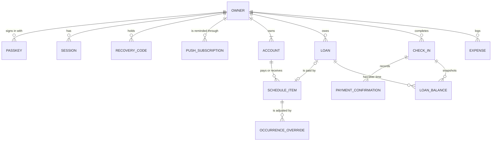

# SPECS

> [!abstract] In one sentence
> A personal budgeting app for someone paid every two weeks: it says what is safe to spend until the
> next payday without missing a bill or loan payment, and when the loans will be paid off.

## Identity

| | |
|---|---|
| Name | Payday — a working name, see open questions |
| One-liner | What is safe to spend until payday, and when the loans end. |
| Repo / package | The owner's own clone of tateru — not the tateru.dev repository itself, see open questions |
| License | Private, personal use; no licence chosen |

## Users and job

One user: the owner. Paid every 14 days, on the same weekday, for the same amount. Bills arrive
monthly on fixed dates. Several loans across all four kinds — credit cards, instalment loans,
buy-now-pay-later and informal loans. Has never kept a budget; tracking never really started.

Two jobs, from [[Paycheck And Bills Out Of Sync]] and [[Getting Out Of Debt]]:

1. *"Tell me what I can spend until payday without missing a bill or a loan payment."*
2. *"Show me what I owe, what it costs me, and when I will be free of it."*

And one constraint that shapes both, from [[Tracking Without Willpower]]: nothing may depend on a
daily habit. The app is used in two moments — a glance at a number on the phone, and a five-minute
check-in every payday — plus a one-time setup.

## Success

> [!success] The one metric
> **Payday check-ins completed on at least 12 of the first 13 paydays after Phase 2 ships** — about
> six months — read from the app's own check-in log.

Two guardrails over the same period, because the habit is only worth having if it does its job:

- No loan payment marked missed at any check-in.
- Total owed at the 13th check-in is lower than at the first.

## Scope — v1

**Phase 0 — Walking skeleton**
- [[Walking Skeleton Deployed]]
- [[Installable App Shell]]
- [[Backups And Restore Drill]]

**Phase 1 — Safe to spend**
- [[Private Single User Access]]
- [[Schedule Of Pay And Bills]]
- [[Paycheck Periods And Safe To Spend]]
- [[Guided First Run Setup]]

**Phase 2 — Payday check-in**
- [[Payday Check-In Flow]]
- [[Payday Reminder]]
- [[Paycheck Plan View]]

**Phase 3 — Loans and debt-free date**
- [[Loan Ledger]]
- [[Debt Free Date Projection]]
- [[Loan Balances At Check-In]]

**Phase 4 — Paycheck list export** (added after v1, 2026-11-01, from [[Handwritten Paycheck List]])
- [[Paid Optional And Grouped Bills]]
- [[Paycheck List Export]]

## Non-goals

| Out of v1 | Why |
|---|---|
| Other users, sign-up, sharing a budget | A personal tool for one owner. Multi-user is a different product. |
| ~~Logging individual expenses~~, categories | v1 infers spending from the balance at each check-in. Per-expense detail returns with [[Bank Statement Import]], after v1. **Superseded 2026-11-02** for expenses, at the owner's request: they are logged from Phase 5, [[ADR-0012 Logged Expenses Count Until The Next Balance]]. Categories stay out. |
| ~~[[Five Second Quick Add]]~~ | Tracking never started, rather than being too slow to keep up, so speed of entry is not the bottleneck. **Superseded 2026-11-02:** committed as Phase 5, [[Daily Expense Log]]. |
| [[Bank Statement Import]] | The strongest v2 candidate, but formats per bank are unchecked and v1 does not need categories. |
| [[Debt Payoff Planner]] | Comparing strategies needs the ledger and a few months of real balances first. Next after v1. |
| [[Cash Flow Runway]] | Overlaps the safe-to-spend number and the paycheck plan; revisit once both are in use. |
| [[Live Bank Sync]], [[AI Capture From Screenshots]] | Cost, security and coverage unverified; low confidence. Stay as seeds. |
| Native app-store apps | Decided against in [[ADR-0002 Installable Web App Over Native]]. |
| Investing, net worth, taxes, more than one currency | Outside the job. |

## Stack

| Layer | Choice | Why | Alternatives considered |
|---|---|---|---|
| Language / runtime | TypeScript on Node.js 26.13.0, the LTS line since 2026-10-28, pinned in `engines` and `.nvmrc` | One language for server, browser and the money-and-date engine; types stop a minor-unit amount being mixed with a float. Costs a build step and type tooling. | Plain JavaScript — no type help for money maths. Bun or Deno — a runtime change with no demand behind it. |
| Framework | SvelteKit (Svelte 5), version pinned by the lockfile from the official `sv` scaffolder | Phone-first glance on mobile data needs a small download; Svelte compiles its framework away. Server routes and form actions in one project serve web and phone from one codebase. Chosen by the owner. Costs a smaller ecosystem than React. See [[ADR-0003 SvelteKit With TypeScript]]. | Next.js — larger ecosystem, heavier JavaScript on the phone. React Router — same React weight. |
| Package manager | pnpm 12.16.1, pinned in `packageManager` | Strict dependency resolution catches packages used without being declared; fast installs in CI. Costs one more tool, installed with npm: Node 26 no longer ships corepack. | npm — default and simpler, but its flat install allows phantom dependencies. |
| Database | **From Phase 6:** Supabase Postgres, reached by the server only; PGlite in development and tests ([[ADR-0014 Supabase Postgres As The Database]]). Until then: SQLite, one file on the host's persistent volume | One user and a few thousand rows a year; no network hop for the most frequent read; trivial local development. Costs a single machine and backups that are this project's job. See [[ADR-0004 SQLite With Continuous Backup]]. | Managed Postgres — a second service and a network hop for no demand; some free tiers pause idle databases. |
| Data access / migrations | **From Phase 6:** Drizzle with the `postgres` driver, migrations run by the deploy ([[ADR-0015 Migrations Run At Deploy]]). Until then: Drizzle ORM with the better-sqlite3 driver; drizzle-kit migrations checked in as SQL | Typed queries close to SQL; migrations are reviewable files. Costs two dependencies and a native module in the Docker build. | Prisma — heavier generated client and runtime. Raw SQL — no typed schema, hand-rolled migrations. |
| Auth | A password (scrypt, from `node:crypto`), with passkeys optional per device as "this device's PIN, fingerprint or face" (SimpleWebAuthn); server sessions in SQLite; one owner, registration closed after the first; one-time recovery codes | The owner chose a password, and found "passkey" confusing. A password works on any device; a device can opt into its own PIN or Face ID for a fast phone glance. Costs: phishing resistance is now optional, so it relies on a strong password, rate limits and a global failure brake. See [[ADR-0010 Password Sign-In With Optional Passkeys]], which supersedes [[ADR-0006 Passkeys For A Single Owner]]. | Passkeys only — phishing-resistant, but confusing to the owner. Password plus TOTP — slow on a phone. Email magic link — needs an email provider. Hosted auth — another vendor holding the door, for one user. |
| Styling / UI | Svelte scoped CSS with design tokens as CSS custom properties in one file; no component library | A handful of screens; every dependency is a permanent cost and a payload. Costs building and testing form controls and accessibility by hand. | Tailwind — extra build tooling and markup noise. A component library — payload the home screen budget cannot afford. |
| Offline and install | A web app manifest plus SvelteKit's built-in service worker | Installs to the home screen on both phones and opens the shell with no signal. Costs a hand-written caching strategy. See [[ADR-0002 Installable Web App Over Native]]. | vite-plugin-pwa with Workbox — more configuration and dependencies than one cached shell needs. |
| Reminders | **From Phase 6:** the calendar file only ([[ADR-0016 Reminders By Calendar File Only]]). Until then: Web Push with VAPID keys through the `web-push` library; a downloadable calendar file as fallback | The payday reminder is what carries the habit. Costs key management, subscriptions that expire, and on iPhone it only works once installed. | Email — needs a provider and is easy to ignore. Calendar file only — no server needed, but no link straight into the check-in. |
| Testing | Vitest for the domain engine and server code; Playwright for flows at phone and laptop sizes | Money and date maths need dense unit tests; the check-in must be proven as a flow. Costs browser downloads in CI. | Jest — slower with ESM and Vite. Cypress — heavier, weaker multi-browser support. |
| Lint / format / typecheck | ESLint, Prettier, svelte-check, offered as add-ons by the `sv` scaffolder | The maintained Svelte toolchain. Costs three tools to keep configured. | Biome — one fast tool, but its support for `.svelte` files has lagged; recheck at setup. |
| CI | GitHub Actions: install, lint, typecheck, unit, e2e, build; deploy on main | The repository already lives on GitHub, and the deploy has to run somewhere other than a laptop. Costs metered minutes on a private repository. | The tateru `pre-push` hook alone — it already runs the checks locally, but it can be skipped and cannot deploy. |
| Hosting / deploy | **From Phase 6:** Netlify's free plan, SvelteKit's Netlify adapter, deploys started on purpose ([[ADR-0013 Netlify As The Host]]). Until then: Fly.io: one small always-on machine with a volume for the SQLite file, a Docker image from adapter-node, deployed from CI | A persistent disk for SQLite, HTTPS and a custom domain handled, within a few dollars a month — pricing and volume support to verify at setup. Costs a Dockerfile, a single region, and brief downtime on deploy. See [[ADR-0005 Fly.io As The Host]]. | A VPS — cheapest, but OS patching, TLS and firewall are this project's job. Vercel or Netlify — no persistent disk, which would force a hosted database. |
| Backups | **From Phase 6:** a full backup the owner downloads from Settings, and restores ([[Backup Download And Restore]]). Until then: Litestream replicating the SQLite file continuously to S3-compatible object storage | Losing the schedule, loans and check-in history would undo months of habit. Costs a second process in the container and a storage account. Maintenance status to verify at setup. | A scheduled `sqlite3 .backup` to storage — simpler, but loses up to a day; kept as the fallback. |
| Secrets / env | `.env` locally, gitignored, keys documented empty in `.env.example`; Fly secrets in production; read through SvelteKit's `$env/static/private` and `$env/dynamic/private` modules | VAPID keys, storage credentials and the WebAuthn origin must never be committed. Costs keeping two places in step. | A secrets manager — overkill for one owner. |

Pin versions where the choice is version-sensitive. `setup` consumes this table literally. No version
number above was looked up; `/setup` pins each from the real scaffolder and lockfile.

## Performance budget

Measured on the owner's own iPhone and Android phone, each budget against the slower of the two. Phase
0 measures them on the deployed skeleton and they become its exit criteria; every later phase
re-checks them.

| Budget | Target | Measured on | Status |
|---|---|---|---|
| Cold open of the installed app to the safe-to-spend number visible | ≤ 2.0 s | Both phones, production, on 4G mobile data; screen recording from tap to number | not yet measured |
| Warm open, shell cached, to the number visible | ≤ 1.0 s | Both phones, production; screen recording | not yet measured |
| JavaScript shipped for the home screen | ≤ 60 KB gzipped | The production build output | **39.1 KB**, 14 files, with Phase 1's home screen — met, 2026-10-31, by `app/tests/budget.e2e.ts` (Phase 0: 33.5 KB) |
| Server time to compute the home screen, p95 | ≤ 150 ms with five years of generated data | Production host, 100 requests | not yet measured on production; locally **22.3 ms** with five years of generated data (40 items, 600 overrides), by `performance.test.ts`, 2026-10-31 |
| Check-in step submitted to next step shown, p95 | ≤ 500 ms | Both phones on 4G, production | not yet measured |

## Data model sketch

- Every amount is an integer in minor units (`*_minor`), per [[ADR-0007 Money As Integer Minor Units]].
  Rates are integer basis points.
- `SCHEDULE_ITEM` has a `kind` — income, bill, loan payment, set-aside — and a repeat rule: every 14
  days from an anchor date, monthly on a day, quarterly, or yearly.
- `LOAN` has a `type` — revolving, instalment, buy-now-pay-later, informal — and the fields that type
  needs.
- Dates are calendar dates in the owner's timezone. v1 shows one `ACCOUNT`; the table allows more.

Enough to start migrations, not a final schema.

## Decisions

| # | Decision | Choice | Rationale | ADR |
|---|---|---|---|---|
| 1 | Build or adopt | Build | The owner asked to create the app and ran `/shape` | [[ADR-0001 Build Rather Than Adopt]] |
| 2 | Platform | Installable web app | One codebase, no app store, push on both phones | [[ADR-0002 Installable Web App Over Native]] |
| 3 | Framework | SvelteKit with TypeScript | Smallest phone download; chosen by the owner | [[ADR-0003 SvelteKit With TypeScript]] |
| 4 | Data layer | SQLite with continuous backup | One user, small data, no network hop | [[ADR-0004 SQLite With Continuous Backup]], superseded 2026-11-02 by decision 17 |
| 5 | Host | Fly.io, one always-on machine | Persistent disk for SQLite, few dollars a month | [[ADR-0005 Fly.io As The Host]], superseded 2026-11-02 by decision 16 |
| 6 | Sign-in | A password, with each device's PIN or face optional (amended 2026-11-01) | Works on any device; the owner chose it | [[ADR-0010 Password Sign-In With Optional Passkeys]], superseding [[ADR-0006 Passkeys For A Single Owner]] |
| 7 | Money | Integer minor units | No rounding drift; hard to change once data exists | [[ADR-0007 Money As Integer Minor Units]] |
| 8 | A bill due on a payday | Counts against the previous paycheck | Pay can land late in the day; the conservative reading never overstates what is safe | — |
| 9 | Spending in v1 | Inferred from the balance at each check-in, not logged per expense | [[Payday Check-In]]; tracking never started | Superseded 2026-11-02 by decision 15 |
| 10 | Credit-card spending before Phase 3 | Visible only when the card is paid | Accepted gap until [[Loan Balances At Check-In]] counts card balance changes | — |
| 11 | When migrations run | At server start, before the first request | Fly's release step runs without the volume; one machine means no race | [[ADR-0008 Migrations Run At Server Start]], superseded 2026-11-02 by decision 18 |
| 12 | Safe to spend with a days-old balance | Counted from the balance's own date, conservatively | Every bill since that balance counts exactly once | [[ADR-0009 Conservative Safe To Spend Rules]] |
| 13 | Optional and paid bills | Still held back by the safe-to-spend number; the marks only label the plan and the export | The owner's choice, 2026-11-01; the balance does not show a payment until the next check-in | [[ADR-0009 Conservative Safe To Spend Rules]] |
| 14 | Export formats | Text, PDF and Word written by the app itself, no new dependency | One short fixed-width list; every dependency is a permanent cost | [[ADR-0011 Exports Written Without New Dependencies]] |
| 15 | Logged expenses (Phase 5) | Each lowers the number at once, until a fresh balance takes over; the check-in compares logged with spent | The owner's choice, 2026-11-02; a balance already covers what came before it | [[ADR-0012 Logged Expenses Count Until The Next Balance]] |
| 16 | Host (Phase 6) | Netlify's free plan, serverless; nothing kept in memory between requests | The owner wants it free, on Netlify, 2026-11-02 | [[ADR-0013 Netlify As The Host]] |
| 17 | Data layer (Phase 6) | Supabase Postgres, server only; PGlite for development and tests; backups downloaded by the owner | No disk on Netlify; the owner named Supabase and chose the download | [[ADR-0014 Supabase Postgres As The Database]] |
| 18 | When migrations run (Phase 6) | In the deploy's build, before the site is published | No server start on Netlify; a failed migration fails the deploy | [[ADR-0015 Migrations Run At Deploy]] |
| 19 | Reminders (Phase 6) | The calendar file only; push removed | Nothing always on to send one; the owner accepted losing reminders to be free | [[ADR-0016 Reminders By Calendar File Only]] |

## Open questions

> [!question]
> - **Where the project lives.** Answered for now, on 2026-10-31: the owner chose to build Phase 0
>   inside the tateru.dev checkout and commit nothing. Still open before the first commit: anything
>   committed here ships to everyone who clones tateru, so the project needs its own repository
>   before CI can run or `/ship` can deploy.
> - **The domain.** Optional passkeys are bound to the domain they were registered on, so changing it later
>   means registering them again. Pick it before Phase 1.
> - **The name.** "Payday" is a placeholder.
> - **Currency and timezone.** Assumed one currency and the owner's local timezone, asked during
>   first-run setup.
> - **Where bills are paid from.** If some bills are paid by credit card rather than from the account
>   pay lands in, the inferred spending in Phase 2 is off until Phase 3.
> - **Reminder time** on payday — a setting, but worth knowing the default.

## Traceability

| Idea | Epics | Delivered in |
|---|---|---|
| [[Safe To Spend Number]] | [[Paycheck Periods And Safe To Spend]], [[Private Single User Access]], [[Guided First Run Setup]] — and the three Phase 0 epics that exist to carry it | Phase 1 |
| [[Recurring Money Schedule]] | [[Schedule Of Pay And Bills]], [[Guided First Run Setup]] | Phase 1 |
| [[Paycheck Period Budgeting]] | [[Paycheck Plan View]] | Phase 2 |
| [[Payday Check-In]] | [[Payday Check-In Flow]], [[Payday Reminder]] | Phase 2 |
| [[Loan Ledger With Debt Free Date]] | [[Loan Ledger]], [[Debt Free Date Projection]], [[Loan Balances At Check-In]] | Phase 3 |
| [[Five Second Quick Add]] | [[Daily Expense Log]], [[Expenses At Check-In]] | Phase 5 |
| [[Safe To Spend Number]] (carried), [[Payday Check-In]] (the reminder) | [[Backup Download And Restore]], [[Postgres On Supabase]], [[Sign-In State In The Database]], [[Deploy On Netlify]] | Phase 6 |

## Setup log

Appended by `setup` after each run, dated.

### 2026-10-31 — Phase 0, first run

Signed off by the owner at the start of this run; the five proposed ADRs are now accepted.

- **Where.** Built in the tateru.dev checkout on `main`, by the owner's choice, with **nothing
  committed or pushed**. tateru's first-run git steps were skipped on purpose: the remote was not
  renamed and the `v*` tags were not moved, because here they are tateru's own release history.
- **Versions, from the lockfile.** Node 26.13.0, pnpm 12.16.1, SvelteKit 3.1.1, Svelte 5.57.3,
  Vite 8.3.5, TypeScript 6.0.3, Drizzle ORM 0.45.4 with drizzle-kit 0.31.11, better-sqlite3 13.0.3,
  Vitest 4.1.12, Playwright 1.64.1. Litestream 0.5.17 in the image.
- **What the scaffolder decided, and what changed.**
  - SvelteKit 3 removed `$lib` and `$service-worker`: imports use `#lib/...` with the file extension.
  - `db:push` was removed, so every schema change is a checked-in migration.
  - better-sqlite3 13 ships prebuilt binaries for every platform, which retires the native-build
    risk in the Docker image.
- **Decisions not in this spec:**
  - Migrations run at server start: [[ADR-0008 Migrations Run At Server Start]].
  - `DATABASE_URL` has no default outside development.
  - CI installs flyctl with Fly's script, not `superfly/flyctl-actions`, whose latest release
    (February 2024) still runs on Node 20.
- **Verified locally:** install, lint, typecheck, 30 unit and 23 browser tests at iPhone, Android and
  laptop sizes, build, and the dev server.
- **Not verified:**
  - CI has never run, because there is no GitHub repository.
  - The Docker image was not built: the owner asked that Docker not be used, so Fly's remote
    builder proves it at `/ship`.
  - `fly.toml` is unvalidated, because flyctl is not installed.
- **Budget:** 33.5 KB of home-screen JavaScript against 60 KB; the server p95 is 11.3 ms locally,
  as a baseline only. Phone and production numbers wait for `/ship`.
- **Dashboard:** `/management`, dev only, built at the owner's request before the app has its own
  components. It passes the conformance contract (296 of 296) and its 17 derivation goldens, and
  adds nothing to the home screen's JavaScript. Revisit it in Phase 1.

### 2026-10-31 — Phase 1, built locally

- **Built:** the money and date engine; passkey sign-in with recovery codes and sessions; the schedule;
  the safe-to-spend home screen; guided first-run setup; and `pnpm seed`.
- **Verified:** 19 of 21 tasks. The suite (393 unit and 162 browser tests) passed three full runs in a
  row.
- **An independent security review found one high and four medium issues; all fixed, each with a
  test.** The high one was an open redirect after sign-in. The mediums:
  - First registration now needs `OWNER_SETUP_CODE` in production.
  - Passkey changes need a fresh passkey confirmation.
  - Sign-in challenges moved to memory, behind a rate limit.
  - Only SvelteKit's static files under `/_app` stay public.
- **Corrected:** adapter-node 6 does not read `ORIGIN`. `fly.toml` sets `ADDRESS_HEADER=fly-client-ip`
  for the rate limit instead.
- **Not verified, needs a person:**
  - a passkey on both real phones, because WebKit in Playwright has no virtual authenticator;
  - first-run setup timed by someone who did not build it.
- **New for `/ship`:** set `OWNER_SETUP_CODE` as a Fly secret, then register at `/signin` with it.
- **Line endings:** a stash and pop on 2026-10-31 rewrote the files with CRLF. `app/.gitattributes`
  now pins LF.

### 2026-10-31 — Phase 2, built locally

- **Built:**
  - the payday check-in: pay, balance, spending, payments confirmed or missed, then the plan;
  - the check-in history;
  - the six-paycheck plan at `/plan`;
  - Web Push payday reminders, sent by a job inside the always-on process, with `.ics` calendar
    fallback.
- **Dependencies:** `web-push` 3.6.7, plus `@types/web-push`.
- **Verified:** 12 of 13 tasks. 515 unit and 224 browser tests, green twice in a row by the builder and
  once more independently. The home screen is 39.8 KB of JavaScript, with a server p95 of 18.8 ms
  locally.
- **Not verified, needs a person or real phones:**
  - subscribing from the installed app;
  - a real reminder arriving;
  - the five-minute stopwatch check-in.
- **Proven only with stand-ins:** the push sender and the service worker's handlers are tested with a
  fake sender and stand-in objects.
- **New for `/ship`:**
  - generate VAPID keys with `npx web-push generate-vapid-keys`;
  - set `VAPID_PUBLIC_KEY`, `VAPID_PRIVATE_KEY` and `VAPID_SUBJECT` as Fly secrets.
  
  With any of the three unset, reminders stay off and say why. Auto-stop must stay off (ADR-0005).

### 2026-10-31 — Phase 3, built and verified locally

- **Built:**
  - one loan model for credit cards, instalment loans, buy-now-pay-later plans and informal loans;
  - payoff projections against a closed-form reference;
  - interest this month;
  - the debt-free date, or an honest "never at this pace";
  - a loans step in the check-in, so a card's balance change finally counts as spending;
  - the history of the total owed.
- **Also:**
  - the reminder subscription now accepts only the known push services' hosts;
  - the payday prompt is unit-tested;
  - `app/README.md` is rewritten.
- **Verified:** all 10 tasks. 644 unit and 256 browser tests.
  - **The performance test** was killed by Vitest's 5-second default time limit on a busy machine; its p95 never broke the budget. Its time limit is now 60 s.
  - **One intermittent browser failure** happened in 6 full runs and didn't reproduce in the next 5. Its cause isn't identified.
- **Budget:** home screen p95 30–63 ms and loans p95 57–70 ms with five years of data, locally; 40.0 KB of home JavaScript.
- **Push-service hosts:** only `fcm.googleapis.com` is confirmed from web-push's source. The Apple, Mozilla and Windows hosts must be checked against a real subscription at release.

### 2026-11-01 — Password sign-in, at the owner's request

- **Changed:** a password is now the primary sign-in, with each device's own PIN, fingerprint or face
  (a passkey) optional. This is [[ADR-0010 Password Sign-In With Optional Passkeys]], superseding
  [[ADR-0006 Passkeys For A Single Owner]].
  - The password is hashed with scrypt from `node:crypto`: N=2^15, r=8, p=3, about 0.28 s locally.
  - Weak passwords are refused against 29,951 common passwords, filtered from SecLists'
    Pwdb_top-1000000 (MIT), and against repeated, run and keyboard-walk patterns.
  - A global failure brake slows guessing but never locks the owner out.
  - Change-password and a recovery path to a new password were added.
- **Two independent security reviews.** The first found one high, two medium and four low findings;
  all are fixed, each proven by a test that failed first. The re-review approved, and its two new low
  findings were fixed the same way:
  - passkey sign-in left the password guess limiter;
  - adding a device re-checks its session before it writes.
- **What's left:** filling the hash queue from about 40 addresses at once can still delay a password
  sign-in on one machine. Existing sessions and passkeys still work.
- **The flaky browser test was a test bug, not an app bug.** The tests' "save balance" helper didn't
  wait for the save's server response, so the next navigation could cancel it.
- **Verified:** 742 unit and 277 browser tests, with password sign-in proven on WebKit, Android and
  laptop profiles.

### 2026-11-01 — Phase 4, the paycheck list export, at the owner's request

- **Added:** [[Handwritten Paycheck List]], as two epics in a new Phase 4. The owner chose that `/`
  means already paid, that groups are their own names per bill, and that an optional bill is still
  held back by the number.
  - [[Paid Optional And Grouped Bills]]: a group and an optional mark per bill (migration
    `0007_paycheck_list`), and a Paid button on the plan, which the next check-in starts from.
  - [[Paycheck List Export]]: each of the next six paychecks downloads as a text file, a PDF or a
    Word document, written with no new dependency ([[ADR-0011 Exports Written Without New Dependencies]]).
- **The owner's sample reproduces line for line**, except its last total: its lines add to 97560,
  where the sample reads 97200. The app computes every total.
- **A download bug found by the browser tests:** links with the `download` attribute were cancelled.
  The attribute hands the request to the browser's download manager, which leaves out a header the
  test server needs to know it is plain http, so the session was not found. The links now rely on the
  server's attachment header alone, which works the same in tests and in production.
- **Verified:** 787 unit and 302 browser tests, twice in a row. Lint, typecheck and build pass. The
  PDF reads back in poppler's `pdftotext`; the Word package reads in Python's zipfile and XML
  parser.
- **What's left:** the owner opening the three files in Notepad, a PDF reader and Word on the laptop,
  and a download from each installed phone app at release.
